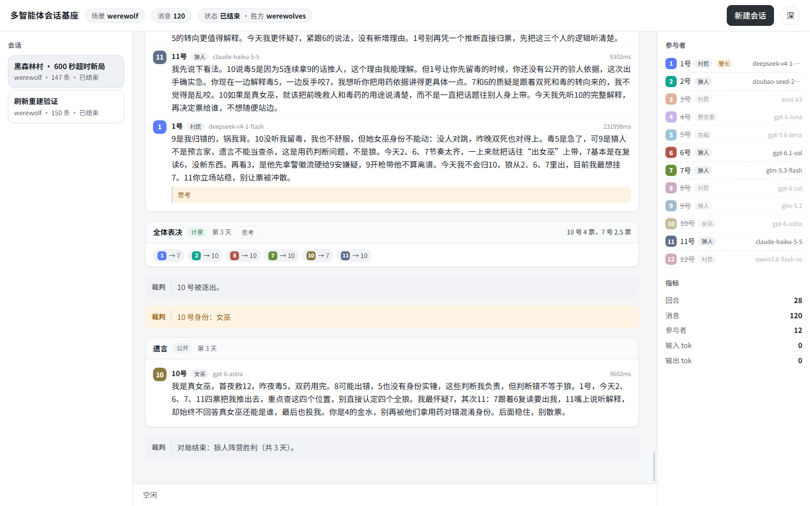
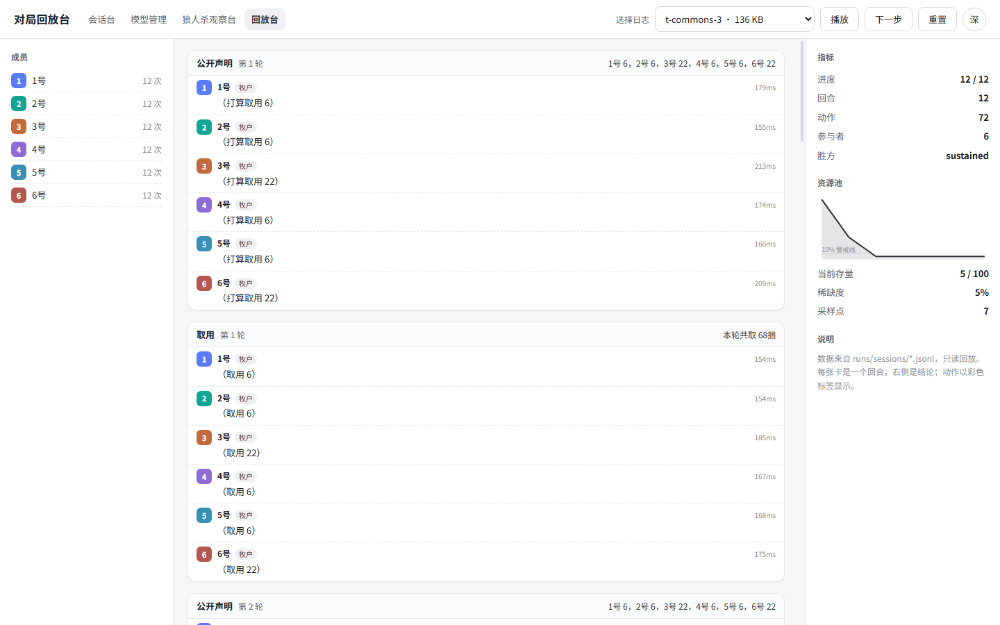
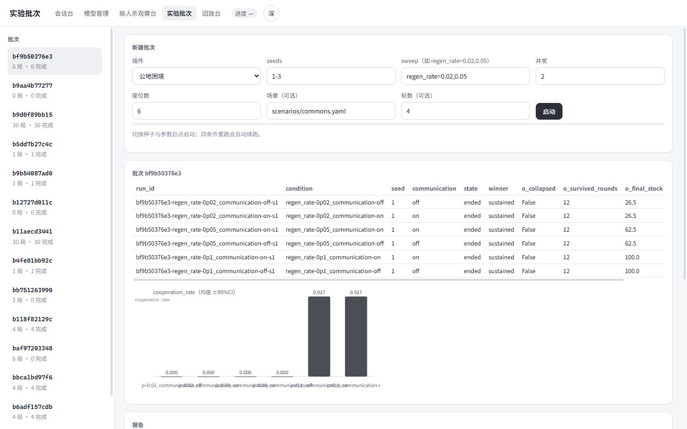

# Silicon Civilization · 多智能体社会仿真基座

一个**零依赖**的多智能体「群聊」基座：把多个模型放进同一个会话，按频道对话、协作或博弈；
具体玩法以**插件**接入，实验能力（批次 / 清单 / 指标 / 报告 / 回放）都在基座里。

> 状态：基座 + 实验层完成（258 项测试）。内置四个场景插件：
> **圆桌讨论**（示例）、**狼人杀**（12/9 人，官方规则）、**公地困境**（资源与合约）、**规则怪谈**（结构化条例）。



## 它解决什么

做多智能体实验常见的三个坑：

1. **只有聊天，没有世界**——没有共享资源、没有所有权，跑不了公地、稀缺、公平这类问题；
2. **只有单局，没有实验**——不能扫参数、不能重复、不能冻结条件，结论无法自证；
3. **只有输出，没有度量**——合作率、基尼系数、违规率全靠人眼看。

这个基座把三件事分别沉淀成：`base/world.py`、`base/batch.py + manifest.py`、`base/metrics.py + report.py`。

## 特性

- **插件化场景**：实现一个 `BaseScenario` 子类即可接入新玩法；玩法进插件，能力进基座。
- **会话 / 频道 / 回合卡 / 裁判**：公共、私密、狼队频道按订阅可见；裁判由确定性程序发言，串起对局节奏。
- **上下文预算**：稳定前缀 + 只追加历史 + 事实卡 + 本轮指令；超预算按优先级裁剪并留痕。
- **流式显示**：SSE 推送，思考与回答分离，已生成的消息不重绘。
- **实验装置**：条件矩阵 × seeds × 并发；条件哈希冻结（manifest）；CSV 汇总 + Markdown 报告 + SVG 图表 + 成本核算。
- **可复现**：同条件重跑自动续跑；会话快照落盘，重启可恢复、可继续。
- **可回放**：会话台逐条重放，回放台按回合回看并画资源曲线。
- **零安装**：仅 Python 标准库 + PyYAML。

## 快速开始

```bash
pip install pyyaml
python server/app.py          # http://127.0.0.1:8765
```

| 页面 | 地址 | 用途 |
|---|---|---|
| 会话台 | `/web/chat.html` | 实时对局 + 历史回放 |
| 模型管理 | `/web/models.html` | 添加/测试模型，按座位分配 |
| 实验批次 | `/web/batches.html` | 起批次、看进度、看报告与图表 |
| 回放台 | `/viz/index.html` | 按回合复盘、资源曲线 |
| 狼人杀观察台 | `/web/werewolf.html` | 旧版专用观察台 |

## 跑一个实验（三步）

```bash
# 1) 批量跑：ρ 三档 × 2 个种子，并发 3
python scripts/run_batch.py --plugin commons --seats 6 \
    --scenario scenarios/commons.yaml --seeds 1-2 \
    --sweep "regen_rate=0.02,0.05,0.1" --concurrency 3

# 2) 产出（自动）
#   runs/batches/<batch_id>/index.csv    逐局结果 + 指标 + token 成本
#   runs/batches/<batch_id>/REPORT.md    条件对比 + 一句话结论 + 成本 + 图表
#   runs/batches/<batch_id>/chart.svg    均值 ±95%CI 柱状图
#   runs/batches/<batch_id>/manifest-*.json  条件冻结清单（可校验是否被改过）

# 3) 回放
#   打开 /web/chat.html 左侧「历史回放」，或 /viz/index.html?log=<session_id>
```

也可以直接在 `/web/batches.html` 页面上填表启动，无需命令行。

## 四个内置场景

| 插件 | 玩法 | 关键指标 |
|---|---|---|
| `discussion` | 圆桌讨论（基座自检） | 发言数、字数、参与者 |
| `werewolf` | 狼人杀：警长竞选 / 自爆 / 狼王 / 白狼王 / 警徽流 / 遗言 | 天数、出局数、调用失败数 |
| `commons` | 公地困境：声明 → 议约 → 取用 → 结算，合约与调解可开关 | 合作率、基尼、崩溃轮次、违约率 |
| `rules_horror` | 规则怪谈：条文由程序检查（禁词/字数/必须发言） | 违规数、违规率、求助次数、存活人数 |

## 指标口径

插件只声明 `metrics()`；通用统计一律由 `base/metrics.py` 计算，保证跨场景可比：

| 指标 | 含义 |
|---|---|
| `cooperation_rate` | 取用不超过公平份额的比例 |
| `gini` | 分配不均程度（0 平均 / 1 独占） |
| `depletion_round` | 资源首次跌破警戒线的轮次 |
| `violation_rate` | 规则怪谈的违规率 |
| `breach_rate` | 合约违约率 |
| `cost_usd` | 按单价换算的估算成本 |

## 写一个场景插件

```python
from base.plugin import BaseScenario

class MyScene(BaseScenario):
    id = "my_scene"
    name = "我的场景"
    default_config = {"rounds": 3}

    def system_text(self, session): ...   # 稳定块（人设/规则）
    def facts(self, session, agent): ...  # 每轮重喂的事实（防记错）
    def validate(self, session, agent, text): ...  # 发言/动作校验（不合格会重说）
    def setup(self, session): ...         # 建频道、建角色、建世界
    def run(self, session): ...           # 回合循环，调用 session.ask(...)
    def metrics(self, session): ...       # 本场景要记录的指标
    def outcome(self, session): ...       # 一局结论（胜方/存活/崩溃）
```

## 目录结构

```
base/       基座：会话/频道/上下文/插件协议/资源/指标/清单/批次/报告/持久化
plugins/    场景插件：discussion、werewolf、commons、rules_horror
engine/     狼人杀规则层与体检（纯函数，不碰 IO）
server/     HTTP 服务：模型注册表、会话/SSE、批次、回放、TTS
web/        页面：会话台、模型管理、批次、旧观察台、主题令牌
viz/        回放台（读真实日志）
scripts/    命令行：跑批次、跑单局、mock 服务、体检
tests/      258 项单元测试
scenarios/  场景预设（狼人杀四种、公地、规则怪谈）
docs/       DESIGN.md（视觉规范）、PLAN.md（任务计划）、BASE_DESIGN.md（架构）
```

## 界面一致性与主题

所有页面共享 `web/theme.css` 的令牌（颜色/字阶/间距/圆角/阴影/动效），
`web/theme.js` 负责深浅色切换与全站导航。品牌色是**偏黑灰**（`--brand`），
改成别的品牌只需覆盖一组变量；页面里已无硬编码色值。

设计取向是 **Material-inspired**（借间距网格、色彩角色、层级与动效节奏），
不使用 Google 的 logo、产品图标或专有字体，也不复刻其具体页面。




## 模型接入

支持三种协议，页面里填 base_url / model / api_key 即可：

| 协议 | 路径 |
|---|---|
| `chat_completions` | `POST {base}/chat/completions` |
| `responses` | `POST {base}/responses` |
| `anthropic_messages` | `POST {base}/messages` |

密钥只保存在本地 `data/models.json`（已 gitignore），接口只返回掩码。

## 测试

```bash
python -m unittest discover -s tests
```

## 隐私与数据

- 仓库不含任何真实 API Key；示例 Key 均为占位符。
- 对局日志（`runs/`）、快照（`runs/state/`）、模型配置（`data/`）默认不入库。
- 截图与示例已剔除内部地址与真实模型标识。

## 许可

[MIT](LICENSE) © 2026 xiaole1173