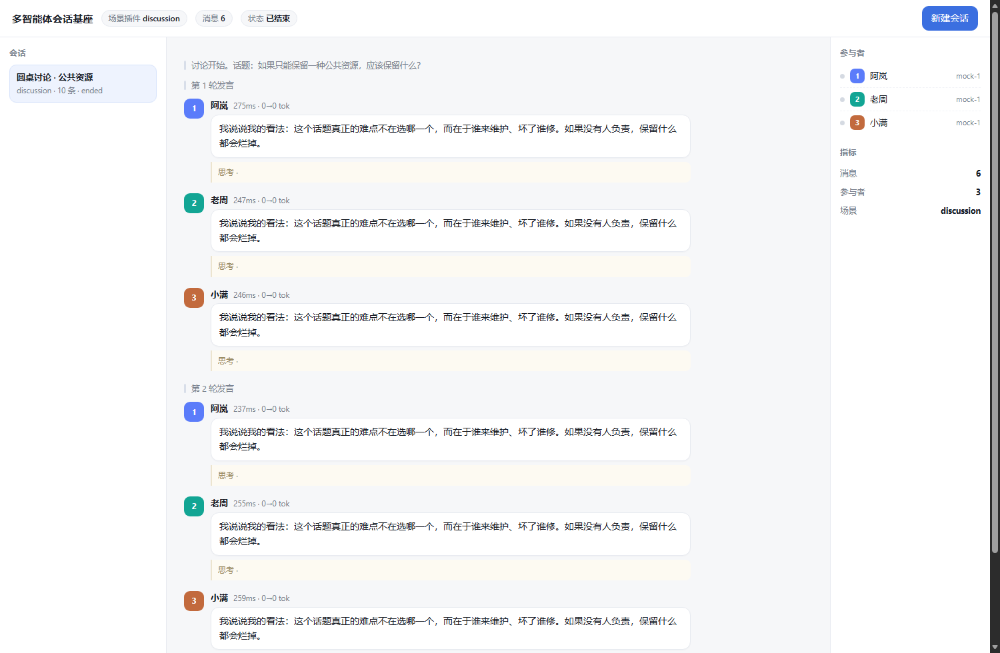

# Silicon Civilization · 多智能体社会仿真基座

一个**零依赖**的多智能体「群聊」基座：把多个模型放进同一个会话，让它们按频道对话、协作或博弈；
具体玩法以**插件**形式接入。自带聊天式观察界面、流式显示、上下文预算与事实校验。

> 当前状态：基座（P1/P2）已完成并通过测试；内置「圆桌讨论」示例场景，狼人杀正在迁移为插件。

## 特性

- **插件化场景**：实现一个 `BaseScenario` 子类即可接入新玩法，无需改动基座。
- **会话 / 频道 / 消息**：公共频道全员可见，私有频道按订阅白名单可见——信息不对称是内建能力。
- **上下文预算装配**：稳定前缀（人设/规则）→ 只追加历史 → 事实卡 → 本轮指令；超预算按优先级裁剪并留痕。
- **SSE 流式显示**：思考与回答分离增量推送，已生成的消息不再重绘（不会闪烁）。
- **任意 OpenAI 兼容端点**：支持 `chat/completions`、`responses`、`anthropic messages` 三种协议，模型/BaseURL/Key 均可在页面填写。
- **可审计**：每条消息与调用（含 token 用量、延迟、上下文裁剪）落 JSONL，可回放。
- **零安装**：仅依赖 Python 标准库 + PyYAML。

## 快速开始

```bash
pip install pyyaml
python server/app.py      # 默认 http://127.0.0.1:8765
```

打开：

- 模型管理 <http://127.0.0.1:8765/web/models.html>
- 会话界面 <http://127.0.0.1:8765/web/chat.html>

在「模型管理」里添加任意 OpenAI 兼容模型（填 Base URL、模型名、API Key），
再在「会话界面」新建会话、为每个座位选择模型即可。



## 目录结构

```
base/          基座：插件协议、会话/频道/消息、上下文装配、事实卡、校验、SSE
plugins/       场景插件（每个子目录一个场景）
engine/        规则引擎与体检（狼人杀使用的纯规则层）
server/        HTTP 服务：模型注册表、会话/SSE、TTS、对局日志接口
web/           页面：会话界面、模型管理
viz/           对局回放台
scripts/       命令行工具（跑对局、体检、离线 mock 服务等）
tests/         单元测试
scenarios/     场景规则预设（YAML）
docs/          设计文档与截图
```

## 写一个场景插件

新增 `plugins/my_scene/plugin.py`：

```python
from base.plugin import BaseScenario
from base.validation import compose_validator

class MyScene(BaseScenario):
    id = "my_scene"
    name = "我的场景"
    description = "一句话说明"
    default_config = {"rounds": 3, "max_chars": 100}   # 会渲染成页面表单

    def system_text(self, session):        # 稳定块：整局不变
        return "场景规则与背景……"

    def facts(self, session, agent):       # 每轮重喂的事实（防记错）
        return {"在场": list(session.agents), "自己的身份": "……"}

    def validate(self, session, agent, text):   # 可选：发言校验
        return True, ""

    def setup(self, session):              # 建频道、分配角色
        session.add_channel("private", "私聊", subscribers=[1])

    def run(self, session):                # 阻塞循环
        for rnd in range(1, 4):
            session.narrate(f"第 {rnd} 轮")
            for aid in sorted(session.agents):
                session.ask(session.agents[aid], f"第 {rnd} 轮，轮到你发言",
                            validator=compose_validator(self.validate))
```

| 钩子 | 作用 | 必需 |
|---|---|---|
| `system_text` | 稳定人设/规则，放提示词最前 | 是 |
| `setup` | 建频道、建角色、开场旁白 | 是 |
| `run` | 回合循环，调用 `session.ask(...)` | 是 |
| `facts` | 每轮重喂的事实卡 | 否 |
| `validate` | 发言/动作校验，不合格会带原因重说 | 否 |

## 上下文与防幻觉

- **上下文**：`system`（不变）+ 历史（只追加，超预算丢最旧、旁白必留）+ **事实卡**（在场/轮次/私有事实）+ 本轮指令。
- **事实卡**：每轮重新告知"确定的事实"，并明确"不在其中的不要编造"——长对话里最有效的防幻觉手段。
- **校验重说**：提到不存在的角色/座位会被判不合格，带着原因要求重说，而不是直接判负。
- 裁剪条数与提示词长度都会写入消息元数据，便于事后审计。

## 模型接入

| 协议 | 路径 | 适用 |
|---|---|---|
| `chat_completions` | `POST {base}/chat/completions` | OpenAI 兼容，绝大多数厂商与本地服务 |
| `responses` | `POST {base}/responses` | OpenAI Responses API |
| `anthropic_messages` | `POST {base}/messages` | Anthropic Messages API |

密钥处理：**只保存在本地** `data/models.json`（已在 `.gitignore` 中），接口只返回掩码；
也支持只填环境变量名，让密钥完全不落盘。

## 测试

```bash
python -m unittest discover -s tests
```

## 隐私

- 仓库不含任何真实 API Key；示例配置中的 Key 均为占位符。
- 对局日志（`runs/`）、模型配置（`data/`）默认不入库。
- 截图与示例已剔除内部地址与真实模型标识。

## 许可

待定（建议 MIT）。在确定许可前，请勿分发或商用。

## 致谢

规则层与评测思路参考了多智能体社会仿真领域的公开工作（如生成式社会模拟与协作博弈评测）。
