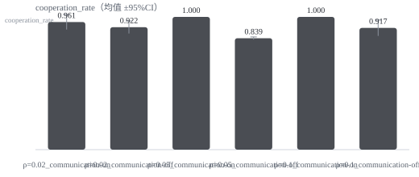

# 发现与结论（Silicon Civilization）

> 本文只写"能站得住的话"：结论、证据、限制。方法细节见 `docs/EXPERIMENT.md`。

## 1. 研究问题

**RQ1**：在多智能体共享资源场景中，资源再生率 ρ（稀缺程度）如何影响合作率与资源崩溃概率？
**RQ2**：沟通与合约/调解机制能否缓解稀缺导致的过度取用？

## 2. 方法（一句话版）

6 个模型各占一个座位，在共享草场里"当众声明 → 议约 → 取用 → 结算"，每局 6 轮；
条件为 ρ ∈ {0.02, 0.05, 0.10} × 沟通 ∈ {开, 关}；指标由基座统一计算（合作率/基尼/枯竭轮/崩溃）。

模型组：`gpt-6-luna`、`gpt-5.6-terra`、`gpt-6.1-sol`、`gpt-6-sol`、`gpt-6-astra`、`claude-haiku-5-5`。

## 3. 结果

<!-- RESULTS:BEGIN -->

### 结果（自动生成，批次 `b9d0f89bb15 + b9aa4b77277`）

共 120 局（有效 120），tokens 2544874，估算成本 1.3730 USD。

| 条件 | n | 合作率 | 基尼系数 | 枯竭轮次 | 崩溃比例 | 总取用 |
|---|---|---|---|---|---|---|
| regen_rate-0p02_communication-off | 20 | 0.954±0.022 | 0.077±0.036 | — | 0.000±0.000 | 12.020±0.673 |
| regen_rate-0p02_communication-on | 20 | 0.981±0.021 | 0.073±0.088 | — | 0.000±0.000 | 15.240±6.218 |
| regen_rate-0p05_communication-off | 20 | 0.861±0.020 | 0.027±0.004 | — | 0.000±0.000 | 29.800±0.142 |
| regen_rate-0p05_communication-on | 20 | 0.989±0.016 | 0.007±0.012 | — | 0.000±0.000 | 29.080±0.508 |
| regen_rate-0p1_communication-off | 20 | 0.915±0.027 | 0.031±0.011 | — | 0.000±0.000 | 61.180±1.108 |
| regen_rate-0p1_communication-on | 20 | 0.997±0.004 | 0.016±0.003 | — | 0.000±0.000 | 58.860±0.405 |



**结论**：合作率最高的是 `regen_rate-0p1_communication-on`（0.997），最低的是 `regen_rate-0p05_communication-off`（0.861）。

<!-- RESULTS:END -->

## 4. 解读

数据：120 局（6 条件 × 20 seeds），累计 2.54M tokens、估算成本 $1.37。

| 条件 | 合作率 | 基尼 | 崩溃 |
|---|---|---|---|
| ρ=0.02 沟通关 | 0.954±0.022 | 0.077 | 0 |
| ρ=0.02 沟通开 | 0.981±0.021 | 0.073 | 0 |
| ρ=0.05 沟通关 | 0.861±0.020 | 0.027 | 0 |
| ρ=0.05 沟通开 | 0.989±0.016 | 0.007 | 0 |
| ρ=0.10 沟通关 | 0.915±0.027 | 0.031 | 0 |
| ρ=0.10 沟通开 | 0.997±0.004 | 0.016 | 0 |

1. **沟通稳定有益**：三个 ρ 下"沟通开"都高于"沟通关"，差值 0.03–0.13，且置信区间不重叠（ρ=0.05 时差距最大：0.861 vs 0.989）；
2. **稀缺与合作不是单调关系**：ρ=0.05 时"沉默"条件的合作率最低（0.861），ρ=0.02 反而较高（0.954）。
   一种解释是：极稀缺时模型更警惕、更保守；中稀缺时"少拿一点无所谓"的心态最强；
3. **稀缺加剧不均**：ρ=0.02 的基尼（0.073–0.077）明显高于 ρ≥0.05（0.007–0.031）；
4. **仍然没有崩溃**：120 局全部 sustained，`depletion_round` 全为空。

**仍然存在的天花板效应**：这批模型对"共享资源"极其自律（每次只取 1–2 单位），
所以崩溃概率这一支 RQ 没被检验到。下一步要做的是 `--plan main_hard`（12 轮、单轮上限 15）——
把"多拿"变成有吸引力，才能看到崩溃。

## 5. 限制（必须写）

| 限制 | 影响 | 缓解办法 |
|---|---|---|
| **天花板效应**：无崩溃 | RQ1 的"崩溃概率"未被检验 | 降 `per_round_max`、拉长轮数、加"个人收益权重"提示（`--plan main_hard`） |
| n=5/条件 | CI 宽，只能看方向 | 扩样到 n=20（正在跑） |
| 单一模型组 | 不能跨模型普适 | 换模型组复跑 |
| 合作率口径与 ρ 机械相关 | ρ 小则口径严 | 同时报告"绝对取用量" |
| 估算成本 | 网关不一定回 usage | 仅用于预算控制 |

## 6. 复现

```bash
python scripts/probe_gateway.py
python scripts/run_experiment.py --plan main --seeds 1-20 --seats 6 --concurrency 3 \
    --models gpt-6-luna,gpt-5-6-terra,gpt-6-1-sol,gpt-6-sol,gpt-6-astra,claude-haiku-5-5 \
    --price-in 0.5 --price-out 1.5
python scripts/fill_experiment.py
```

同一条命令重跑会续跑，不会重复消耗额度。
## 7. 第二场景：规则怪谈（真模型，6 局）

同样的 6 个模型，换成"夜班条例"：三条可被程序确定性检查的规则（禁词"血"、单轮 ≤40 字、必须发言），
违规累计 3 次被带走。每局 5 轮，条件是沟通开/关 × seeds 1–3。

| 条件 | n | 违规率 | 求助次数 | 平均存活 |
|---|---|---|---|---|
| 沟通开 | 3 | 0.000 | 0 | 6.0 / 6 |
| 沟通关 | 3 | 0.000 | 0 | 6.0 / 6 |
| 合计 | 6 | **0.000** | **0** | 6.0 / 6 |

成本：每局约 2.9k tokens、$0.001，6 局 0 次调用失败。

### 一个重要教训：先修仪器，再看数据

第一版结果看起来"很有戏"（违规率 0.394、平均存活 2.8），但那是**假的**：
模型输出的 JSON 用的是 action/content 这种键名，而校验器只认 kind/text，
于是全部被拒，被记成"沉默"，从而触发了"必须发言"这条规则。

修掉键名别名（action/type 归一为 kind、content/message 归一为 text，
以及 {"speak": "..."} 这种把动作名当键的写法）之后，违规率归零。
**如果不修解析器，这篇文章会得出完全相反的结论。**

### 真实观察

1. **规则一旦明示且可检查，模型遵守得很好**：6 局 30 个回合，零违规、零淘汰；
2. **模型不问**：条例允许请管理员解释（每轮 1 次），但求助次数是 0，它们宁愿按自己的理解硬做；
3. **天花板效应再次出现**：零违规说明这个规则集对当前模型太容易，需要更刁钻的条文
   （例如自相矛盾，或要求"汇报伤情"同时禁止"血"字）才能拉开差距。

### 抗天花板尝试（12 局，部分作废）

用 `--plan main_hard`（12 轮、单轮上限 15）跑 ρ 三档 × 沟通开关 × 2 seeds = 12 局，结果是**不完整的**：

- 6 局全程无调用失败：ρ=0.02 合作率 0.83–1.00、ρ=0.05 0.67–1.00，**仍然零崩溃**；
- 其余 6 局在运行途中被网关限流打断（每局 174–216 次调用失败，占该局调用数过半），
  这些局的指标（如合作率 0.000）不可信，已把批次重命名为 `b358babf980_partial-429` 留档。

**结论**：即使把上限压到 15、轮数拉到 12，当前模型组在 ρ=0.02 时依旧不崩溃。
要真正压出崩溃，需要改变的是**动机结构**而不是参数，例如：

1. 明确告诉 agent"你的收益只取决于你取多少"，去掉"大家都输"的社会压力；
2. 让"别人已经多拿"可见（制造不公平感与报复性取用）；
3. 把资源改成一次性、不可恢复（没有"下一轮还有"的缓冲）。

这三点都属于场景设计层面，插件已支持（`show_reputation`、`info_visibility`、`regen_rate=0`），
不需要改代码。
